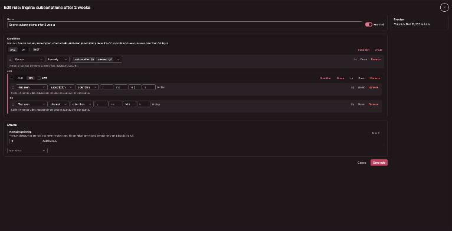
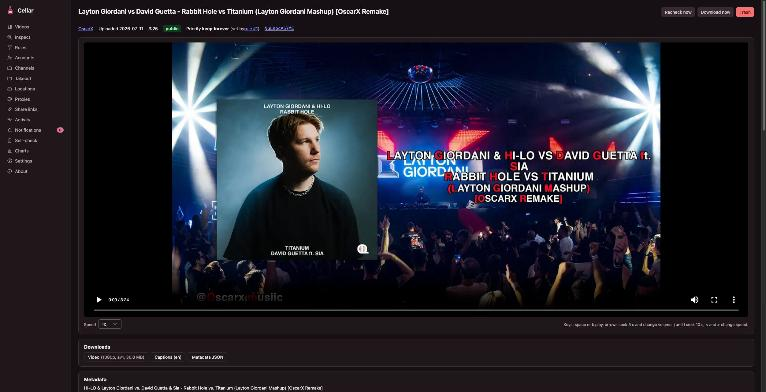
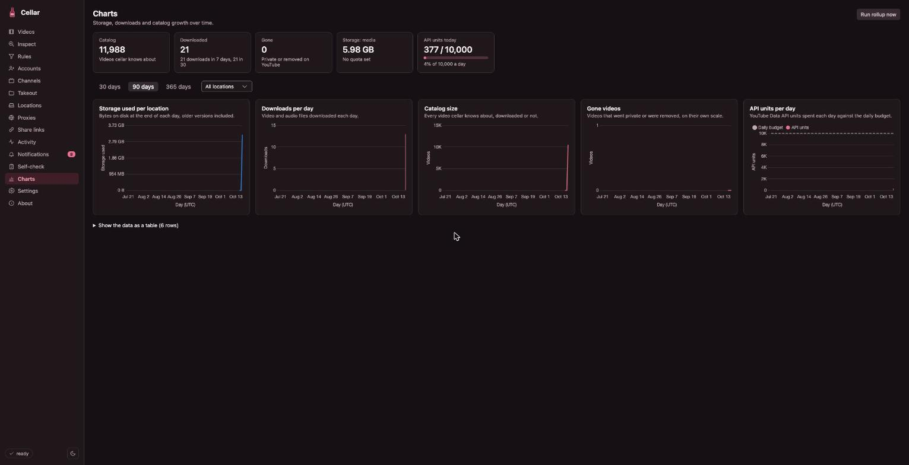

# Cellar

Cellar is a self-hosted, single-tenant YouTube archiver. It links your Google
accounts, watches what you watch, like, add to Watch Later or subscribe to, and
keeps the videos on your own storage under a rule system you control. It stores
every piece of metadata and its change history in SQLite, transcodes with your
GPU, reaps storage by priority, notifies you when a video goes "gone", and ships
as a single Docker image.



## What it does

- **Sources**: watch history and Watch Later (through your cookies and yt-dlp),
  liked videos, subscriptions and channel uploads (YouTube Data API), manually
  added channels, and a Google Takeout importer for the full history.
- **Rules**: a global default, drag-ordered custom rules with nested AND/OR/NOT
  conditions (account, source set, type, channel, status, duration, views,
  likes, estimated like ratio, codecs, title/description/tags text and regex,
  upload date, first-seen age, and more), and per-video overrides. Rules decide
  inclusion, reclaim priority, storage location, media mode, format policy,
  transcoding, captions, yt-dlp and proxy options, delays, recheck cadence and
  notifications. Retention is emergent: a higher-priority rule that sets
  priority 0 after N days is how "keep for N days" is expressed.
- **Media pipeline**: downloads with yt-dlp (PO-token sidecar, cookies written
  back after each run, proxies, per-account budgets), keeps AV1 when YouTube
  offers it and otherwise transcodes to HEVC with NVENC (software SVT-AV1 as a
  fallback), moves media between storage locations when rules change, and reaps
  the lowest-priority media when a location fills up. Priority 0 means "delete
  now and never re-download"; metadata, history, captions and thumbnails are
  never deleted.
- **Admin UI**: server-side paged catalog with full-text search, in-browser
  playback with captions and speed control, bulk ZIP or folder downloads with
  filename templates, Inspect (paste any identifier, see which rules match and
  the effective settings), accounts, channels, locations, proxies, activity and
  job logs, notification inbox with Web Push, a comprehensive self-check and
  progress charts.
- **Public share links**: `/s/<token>` opens without authentication through a
  Cloudflare Access bypass, plays with captions, allows downloads, is
  noindexed, expires or is revoked at any time, and leaks nothing: every
  unknown, expired or revoked token answers the same 404.





## Stack

Node 26, TypeScript, Fastify 5, node:sqlite, Vue 3 + PrimeVue 4, Vite,
Playwright, vitest. yt-dlp and ffmpeg (BtbN static build) are baked into the
image and updated in place by the app. One container plus two sidecars
(watchtower for updates, bgutil for PO tokens). See
[docs/ARCHITECTURE.md](docs/ARCHITECTURE.md) for the full design.

## Deploying

Cellar is built for a NAS behind a Cloudflare tunnel with Cloudflare Access in
front of everything except `/healthz` and `/s`:

1. Create the data and media datasets, owned by an unprivileged uid (the compose
   file uses 3100:3100), and write `.env` from [`.env.example`](.env.example).
2. Create the Access applications and the tunnel hostname:
   [docs/setup-cloudflare.md](docs/setup-cloudflare.md).
3. Create a Google OAuth client (YouTube Data API v3, Web application, published
   to Production so refresh tokens do not expire every 7 days) and put its id
   and secret in `.env`.
4. Run [`deploy/docker-compose.nas.yml`](deploy/docker-compose.nas.yml) as a
   Custom App (or with plain docker compose): [deploy/README.md](deploy/README.md).
5. Open the Accounts page, add an account per Google identity, link it, and
   paste a Netscape `cookies.txt` exported from a private browser window.

Every push to `main` builds and smoke-tests the image and publishes it to GHCR;
watchtower pulls it within minutes.

## Developing

```bash
npm install
npm run dev              # server on :8080 and the Vite dev server on :5173
npm test                 # vitest across shared, server and web
npm run test:e2e         # Playwright against the built server (no auth)
npm run lint && npm run typecheck && npm run build
```

`INSECURE_ALLOW_PUBLIC_ACCESS=1` runs the server without Cloudflare Access,
bound to loopback, for local work. The fake yt-dlp and ffmpeg shims in
`scripts/fake-bin` make the whole pipeline testable without network or GPU.

## Security

See [SECURITY.md](SECURITY.md) for the threat model: what the public share
surface exposes, how cookies and tokens are stored, container hardening, and
how to report a problem.

## License

MIT. See [LICENSE](LICENSE).
